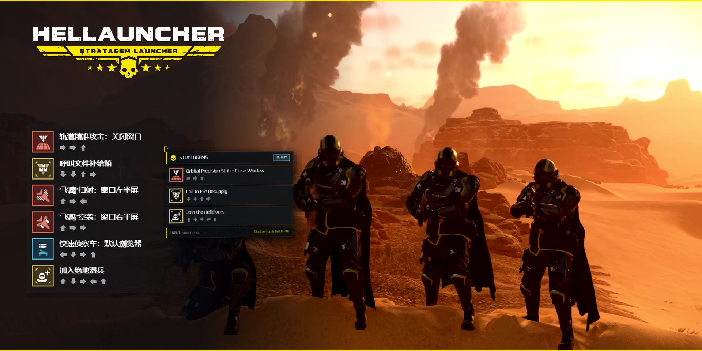
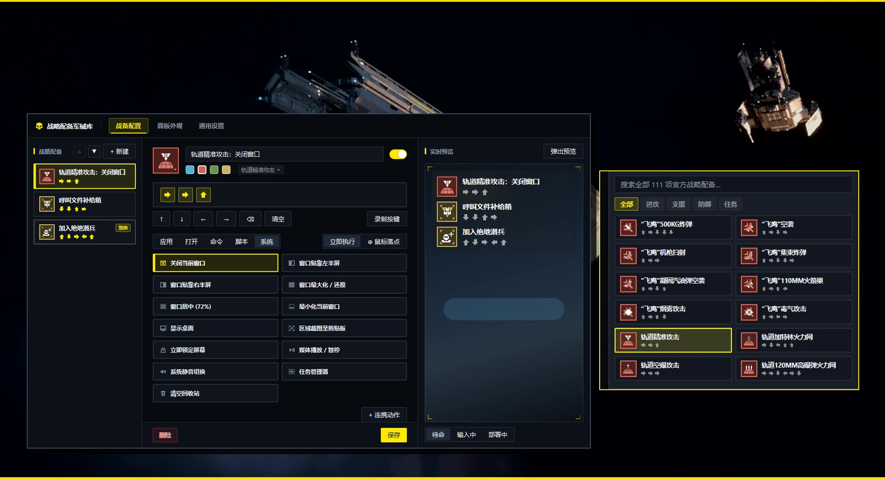

<p align="center">
  
</p>

<h1 align="center">HelLauncher · 绝地战备桌面启动器</h1>

<p align="center">
  <strong>管理式民主，值得更高效的快捷键。</strong><br/>
  在地球办公室遇事不决？双击按住 <code>Ctrl</code>，直接搓招！
</p>

---

**真理部联合认证生产力装备** —— 把《绝地潜兵 2》（*Helldivers 2*）的战略配备呼叫终端搬到你的桌面。不靠鼠标翻来覆去找窗口，不碰卡顿笨重的网页套壳；双击 `Ctrl` 抬腕搓出一串 `↑ ↓ ← →`，伴随原版蜂鸣声与头盔面甲 HUD，秒开软件、整理窗口、清场划水或直接投身前线，随时随地**来一杯解放茶（Liber-Tea）☕**。

## ⚡ 战备特性

- **抬腕即搓，管理式极速调度**：双击按住 `Ctrl`（支持自定义左/右 `Ctrl` 或单按切换）呼出战术面板，用 `WASD` 或方向键高速搓招，触发打开应用、文件/URL、Shell 命令、脚本及窗口管理等动作。
- **头盔面甲视觉 & 原版音频矩阵**：基于原生 GPU 渲染透明悬浮窗，内置**原版经典**与 **3D 面甲折射战术**双主题 HUD，还原官方字体、111 枚战略配备矢量图标与输入/失败/部署原声音效。
- **真理部强力征召播报**：首次入列即全屏播放 4 幕踩点高燃战备混剪与《A Cup of Liber-Tea》交响主题，随后在实时桌面 HUD 上手完成主题切换、热键校准与实弹搓招演练。
- **战区智能静默旁路**：全屏游戏运行期间自动静默退避，决不抢夺前线潜兵的任何一次关键操作焦点。
- **一键增援直连前线**：内置最高优先级的 `↑ ↓ → ← ↑` **加入绝地潜兵** 指令，配合战备舱锁死与发射原声，一秒空投《绝地潜兵 2》（尚未购置战甲的新兵将自动空投至征兵页面）。

## 🎯 标准出舱配装

开箱即预装以下核心民主工具（均可在军械库自由改键、增删或联动多步动作）：

| 指令序列 | 战备名称 | 默认战术效果 |
| :---: | :--- | :--- |
| `→ → ↑` | **轨道精准攻击：关闭窗口** | 精准消灭当前前台卡死或摸鱼窗口 |
| `↓ ↓ ↑ →` | **呼叫文件补给箱** | 呼出系统文件资源管理器 / Finder |
| `↑ ↓ → ← ↑` | **加入绝地潜兵** | 启动《绝地潜兵 2》（系统内置） |

> 💡 **军械库一键模板** 还附带 **“飞鹰”扫射**（`↑ → ←` 左半屏分屏）、**“飞鹰”空袭**（`↑ → →` 右半屏分屏）与 **快速侦察车**（`← ↓ → ↑` 默认浏览器）等常用预设。

## 🛠️ 战略配备军械库

支持自定义触发键位、111 款官方战略配备图标检索、连携组合动作与实时 HUD 预览，所见即所得：

<p align="center">
  
</p>

## 🚀 快速部署与编译

### 直接部署（Windows）

前往 Releases 下载最新版安装包 `hellauncher-setup-0.2.0-amd64.exe` 双击安装即可入列服役；启动后常驻系统托盘，点击托盘图标即可随时呼出军械库或重温真理部播报。

### 源码构建（Go + Bun / MyGo 原生零 CGO）

```bash
bun install

# 启动本地热重载调试
bun run dev

# 静态检查（gofmt + mygo vet + 三端 CGO_ENABLED=0 交叉校验）
bun run check

# 运行单元测试与实时 GPU 端到端冒烟验证
bun run test
bun run e2e

# 打包 Windows 生产安装包（输出至 build/）
bun run installer:win
```

---

<p align="center">
  <em>为了超级地球。愿你的每次搓招零失误，你的窗口永远整齐划一。</em> 🫡
</p>
